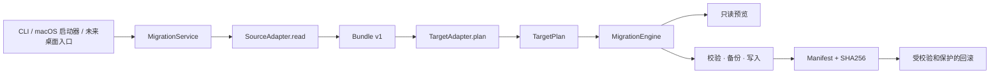

# 迁移架构

## 模块边界



- `models.py` 定义与客户端无关的 `Bundle / Session / Message / Document`，保留源会话 ID、工作目录、消息类型、文档作用域、归档来源和原始记录。`schema_version=1` 为格式演进边界。
- `adapters/codex.py` 只读源文件和 SQLite，原始 rollout 优先；可见 UI 投影仅在必要时回退，避免一条消息同时作为原始记录和 UI 镜像导入两遍。未明确选择项目时，从本次选定的会话工作目录推导有边界的现存项目根；后续读取排除自身生成的规则区域和 `.dsh` 输出。
- `adapters/deepseek.py` 输出目标相对路径和字节内容，不执行写操作。客户端专属编码、项目目录键、会话封装、资料索引及能力降级都在这里处理。
- `registry.py` 显式注册独立的 source 和 target。支持 N 个 agent 时，读取器和写入器各自增长，核心不维护 N×N 方向判断。
- `engine.py` 统一验证路径、冲突策略、目标是否自预览后改变、并发锁、原子替换、恢复日志与回滚。引擎不理解 Codex 或 Harness 的事件类型。
- `service.py` 是应用层入口，可直接供桌面应用或 HTTP 服务调用；CLI 只是它的一种使用方式。

## 当前数据映射

Codex 的 `response_item` 转换为统一消息；`compacted` 转成摘要。完整原始事件保留在 bundle。SQLite fallback 读取 `thread_items.item_json`，补齐公开的用户/助手/工具记录，并发出原始记录不可用的警告。

Harness 会话使用稳定的 UUID v5，命名空间包含源 agent 与源会话 ID。Session v4 记录按照 native `turn/start`、`step/start`、message、`step/end`、`turn/end` 排列。用户和助手对话保留相应角色；历史工具、摘要、原有系统和开发者上下文以标记来源的 recall 消息表示。不会把旧客户端的工具调用作为目标客户端的待执行动作。

Zstandard 模式使用两个独立的标准帧：第一帧仅 header 行，第二帧是事件正文，符合 Harness 独立读取 header 的方式。编码使用标准 raw blocks，因此没有第三方写入依赖，文件大小接近未压缩文本。`none` 模式输出普通 JSONL。压缩模式必须与 Harness 对应持久化后端的配置一致。

原生目录大致如下，项目键与路径转义按已验证客户端算法生成：

```text
DSH_HOME/
  AGENTS.md
  skills/
  imports/codex/documents/
  sessions/<project-key>/<stable-session-id>/session.v4.jsonl.zstd
  .migrate-agent/
    bundles/<content-sha256>.json
    runs/<run-id>/
      manifest.json
      backups/
```

文档副本保留原始相对路径和项目归属。全局和项目 `AGENTS.md` 的导入区域有稳定边界标记，重复迁移替换相应区域并保留无关目标文字。项目规则按原来的目录作用域安装到映射项目的原生 `AGENTS.md`，配置中的用户指令落在其配置所属目录；源 override 替代失效 base 的含义在转换时处理。

项目技能整体安装到 `<mapped-project>/.dsh/skills/<skill>/SKILL.md` 与同目录资源，规范化 native 名称/调用字段，保留显式调用限制和可执行脚本能力。规则和技能由客户端的新会话加载器发现，不依赖导入的历史上下文。

`TargetPlan.project_roots` 显式注册本次项目输出根，`PlannedFile.root` 指向相应项目。引擎仅接受 bundle 中项目经路径映射得到的目录，拒绝对 `.git`、源 `.codex` 和迁移控制文件写入。全局与所有项目变更共用同一 manifest、备份和校验和回滚；临时的目标文件锁防止不同 Harness home 同时改写同一项目文件。`PlannedFile.merge` 表示适配器完成的托管合并，默认允许备份后更新；普通冲突沿用 abort/skip/overwrite。

## 接入其他 agent

1. 实现 `SourceAdapter`：提供稳定 `name` 与 `read(SourceOptions) -> Bundle`。无法表示的字段保留在 `records/metadata`，不完整读取必须发出警告。
2. 实现 `TargetAdapter`：提供 `name` 与 `plan(Bundle, TargetOptions) -> TargetPlan`。输出的每个 `PlannedFile` 必须是目标根下的相对路径；不得在 adapter 中写盘。
3. 在 `AdapterRegistry` 注册；对该客户端的实际读取器进行兼容性验证。只有某个方向可用时，可以仅注册 reader 或 writer。
4. 增加来源格式、能力降级和目标恢复测试。事务、回滚与冲突逻辑复用统一引擎。

```python
registry.register_source(NewAgentSource())
registry.register_target(NewAgentTarget())
service = MigrationService(registry)
plan = service.prepare("codex", "new-agent", source_options, target_options)
report = service.engine.apply(plan)
```

未来可在这个边界上增加批次/流式 bundle、附件映射、MCP 配置翻译和目标能力探测。当前没有把未验证格式的其他 agent 列为已支持。

## 验证依据

本实现于 2026-11-16 检查本机 DeepSeek Harness `0.2.2-rc.3` 随附的 `@deepseek-ai/dsh-session`、`dsh-session-format-catalog`、`dsh-session-persistence-jsonl`、`dsh-home-paths`、`dsh-agent-instructions` 和技能加载包源码。

额外兼容性验证使用其原生 `scanZstdFrames()`、`sessionFormatCatalog.createRestore(header, { recovery: 'strict', validation: 'current' })`、`Session.fromRestore()` 和 `deriveMessages()`，检查生成文件的帧、事件和恢复后的模型可见历史。验证在临时目录完成，没有向真实 Harness 数据目录写入会话，也没有调用模型。

仓库提供可重跑的只读原生检查器，需要支持 Zstandard、同步 module hooks 与 TypeScript transform 的 Node（开发验证使用 Node 25），以及安装包中含相关依赖的 `node_modules` 目录：

```bash
node --experimental-transform-types scripts/verify_deepseek_native.mjs \
  /path/to/harness/node_modules \
  /path/to/session.v4.jsonl.zstd
```

检查器在内存中转换安装包的 TypeScript 源码，不改写安装目录；输出事件和消息数量，不打印对话正文，也验证 assistant stream 能够原生解码。

项目原生检查器 `scripts/verify_deepseek_project.mjs` 读取已迁移目录，在全新空 `Session` 下调用官方 `loadBaselineInstructionSet()`，随后装配原生 `SkillRegistry` 和 `skill-filesystem`，执行目录快照、技能加载和原生 `renderSkillContent()`。可选集成测试 `tests/test_native_project.py` 从 Codex fixtures 完成迁移，再验证跨项目映射、原地 override、父子作用域、同级隔离、技能相对资源及脚本实际执行，最后验证回滚。这个流程不需要模型 API，也不读取真实用户项目。

2026-11-16 验证结果：Python 3.9 和 3.13 各执行完整 107 项测试，全部通过，包括启用本机 Harness 原生依赖的两项集成测试。项目验证覆盖 5 个新建空会话、11 次原生技能正文加载、8 次原生 `skill` 工具执行、12 项相对资源检查，并直接执行了迁移后带执行权限的测试脚本。显式禁止模型调用的技能保持禁止，原生工具拒绝该调用；嵌套技能展开后仍可发现和读取其资源。规则合并、首次迁移后立即重复运行、跨项目事务回滚均通过。

Codex 配置层次的官方参考：[Config basics](https://learn.chatgpt.com/docs/config-file/config-basic)。会话磁盘格式属于客户端实现细节，本适配器根据实际文件结构和 SQLite schema 读取；不能把它视为稳定的官方跨客户端导出协议。
